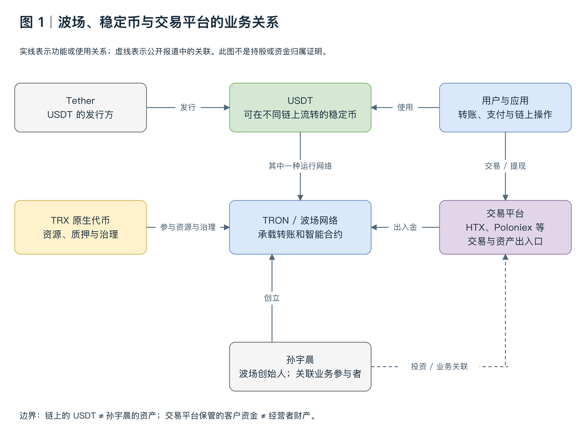
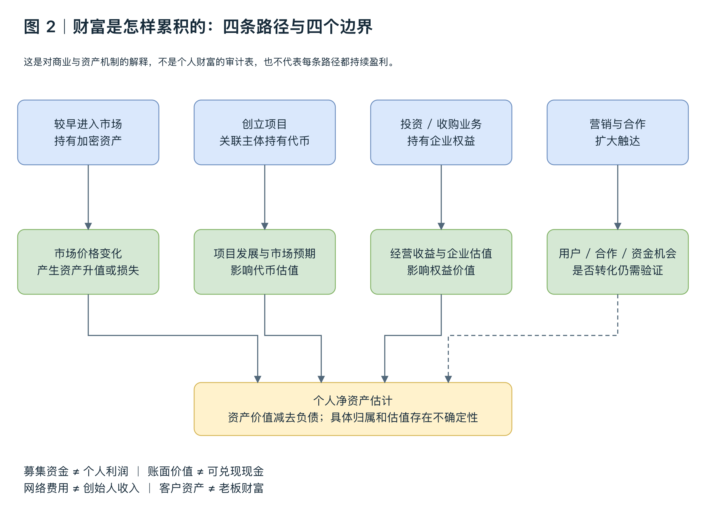
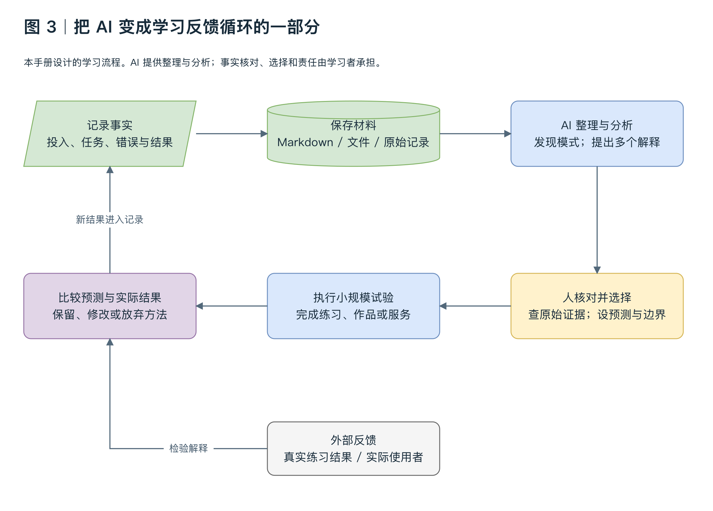
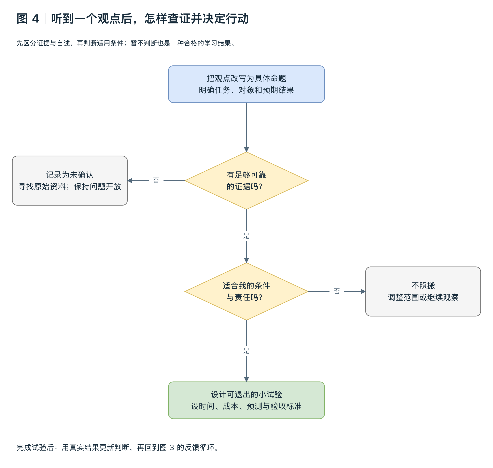

# 邵艾伦与孙宇晨访谈深度学习手册
从 AI 工作流到机会选择与长期创造

这场约四小时二十二分钟的访谈，最值得学习的是一套不断修正行动的方法：整理自己的信息，扩大可见的选择，在真实情境中尝试，再用结果更新判断。AI、身体状态、职业机动性和个人表达，是两位对谈者反复讨论的切入点。

学习目标不是复述他们的口号，而是能够回答三个问题：某个观点为什么可能成立；它在哪些条件下会失效；我能用什么小实验检验它。读完后，你应当获得一份自己的机会清单、一套可持续的记录习惯，以及一个有验收标准的行动项目。

本手册把内容分为三层。访谈观点，是对两位说话者意思的归纳；学习分析，是对观点的机制、前提和反例的拆解；练习与计划，是本手册设计的学习活动。后两层不应被当成孙宇晨或邵艾伦的原话。

正文主要依据 LeoLee0812 整理的第三方逐字稿。该稿保留口语重复，并标出若干存疑词句；它适合定位与学习，引用原话时仍需回看视频。文中的时间戳沿用这份稿子，不代表已逐句核对原音。涉及数字、产品价格、人物轶事和未来预测，应分别核查。

### 怎么使用这份手册
第一遍，先读第 0 节了解人物背景，再读第 1 节与第 2 节理解全局。第二遍，每次选择一个主题，回看对应视频，再读分析与练习。第三遍，把个人实验跑完，写出哪些判断改变了。若时间有限，优先学习 AI 工作流、先探索再选择、用反馈更新判断这三个主题。

建议在笔记中记录四种标记：同意；有条件同意；需要证据；已经试过。每个标记都补一句原因。只有“同意”而没有条件和证据，容易把学习变成认同。

初次整理：2026 年 10 月 11 日；人物背景与图解更新：2026 年 10 月 12 日。

本次新增人物背景与四张结构图。图解是本手册的学习辅助材料，不能当成访谈中的原始图表。

## 0 先了解孙宇晨：经历、财富来源与争议

本节依据访谈之外的公开资料补充人物背景，资料核对日期为 **2026 年 10 月 12 日**。它不属于原访谈逐字稿。理解孙宇晨，需要分别考察商业能力、产品用途、市场行为和个人观点，不能用财富或声望替代具体证据。

### 0.1 他是谁，主要做过什么

孙宇晨，英文名 Justin Sun，1990 年 7 月出生，本科毕业于北京大学，之后取得美国宾夕法尼亚大学硕士学位。其公开身份主要是波场 TRON 创始人及加密行业企业家，也曾担任格林纳达常驻世界贸易组织代表。教育信息可见 [Milken Institute 嘉宾履历](https://milkeninstitute.org/events/asia-summit-2023/speakers/justin-sun)；该页面注明履历由嘉宾提供，不能把它当成独立背景调查。

| 阶段 | 主要经历 | 理解这段经历的意义 |
| --- | --- | --- |
| 早期 | 在 Ripple 工作，负责中国市场相关业务 | 接触加密支付、行业合作和市场推广 |
| 移动互联网创业 | 创办语音社交应用“陪我” | 积累消费产品与营销经验 |
| 2017 年 | 创立波场 TRON，开展 TRX 代币发行 | 建立自己的区块链项目与融资渠道 |
| 2018 年 | 波场主网上线；收购 BitTorrent | 发展独立网络，并扩展业务与品牌 |
| 2019 年起 | USDT 引入波场；参与交易平台业务 | 扩展稳定币转账及交易服务 |
| 后续 | 围绕 HTX、Poloniex 及链上金融项目开展投资和业务活动 | 从单一项目扩展到多种加密业务 |

来源：[Forbes 人物报道](https://forbes.es/economia/664402/quien-es-justin-sun-el-criptomillonario-que-ayudo-a-los-trump-a-ganar-400-millones-de-dolares/)、[波场官方时间线](https://tron.network/about/?lng=en)、[Arkham 财富研究](https://info.arkm.com/research/justin-sun-net-worth-2026)。交易平台的具体持股比例和关联主体关系并未全部公开，不宜把“顾问”“投资者”“控制人”当成完全相同的身份。

### 0.2 波场、USDT 和 TRX 到底是什么关系

波场是一套承载转账与智能合约的区块链网络。它的重要应用之一，是转移 USDT 稳定币。2019 年，Tether 宣布将 USDT 引入波场，使用户能够通过波场网络转移这项资产。[Tether 官方公告](https://tether.io/news/usdt-introduced-to-tron-blockchain/)

三个概念要分开：

- **USDT** 是由 Tether 发行、目标是跟随美元价值的稳定币。
- **TRON／波场** 是承载交易和程序的网络；USDT 也能在其他网络上运行。
- **TRX** 是波场的原生代币，与资源、质押和治理有关。网络操作需要带宽、能量等资源，资源不足时可能消耗 TRX 支付费用。

例如，交易平台提现页面上的“USDT—TRC20”，通常表示通过波场网络转移 USDT，而不是购买 TRX。孙宇晨不是 USDT 的发行人；波场上流转的 USDT 也不能全部算成他的财产。[波场资源机制](https://developers.tron.network/docs/resource-model)

**图 1 阅读提示：**实线描述功能或使用关系，虚线描述公开报道中的业务关联。这是一张帮助理解角色的架构图，不是法律上的持股关系图。网络、资产发行方和交易平台承担不同职能。

### 0.3 为什么他能够积累这么多财富

其财富应从资产和业务两方面理解，而不能只归因于“个人认知”。早期进入加密市场、持有代币、发展项目及投资企业，都可能影响财富。Forbes 在 2026 年 10 月 12 日页面上给出的净资产估计为 **85 亿美元**。这是外部估值，不是公开审计后的现金余额。[Forbes 财富资料](https://www.forbes.com/profile/justin-sun/)

1. **资产价格变化。**早期持有的加密资产，如果之后价格大幅上涨，会形成账面财富；价格下跌也会减少财富。具体每笔投资赚了多少，不能只凭访谈自述确认。
2. **项目相关代币。**项目发展与市场预期会影响代币价值，创始人或关联主体的持仓可能因此升值。个人持有量、基金会持有量和交易平台客户持仓必须区分。
3. **企业权益与经营收益。**交易平台和其他业务可以产生经营收益，企业权益也有估值。但企业的成交额、客户资产和老板净资产是不同指标。
4. **传播与合作机会。**营销可能带来用户、合作与资金接触，但注意力是否转化成利润，需要数据验证。此项是本手册的机制分析，不是个人收益核算。

**图 2 阅读提示：**四条路径解释财富可能怎样形成；第四条虚线表示间接且有条件的影响。它不是证明每项业务成功的因果图，也不是个人财产审计。

报道指出波场在 2017 年通过 ICO 募集约 7,000 万美元。ICO 是向购买者出售代币筹资，与出售公司股票不同；募集款也不能直接视作个人利润。[Forbes 报道](https://forbes.es/economia/664402/quien-es-justin-sun-el-criptomillonario-que-ayudo-a-los-trump-a-ganar-400-millones-de-dolares/)

一个说明机制的假设例子：持有一亿枚代币，单价从 0.01 美元涨到 1 美元，账面价值就从一百万美元变成一亿美元。但集中出售可能压低价格，无法保证按屏幕报价全部兑现。

**四条财富边界：募集资金不等于个人利润；账面价值不等于现金；网络费用不等于创始人收入；客户资产不属于经营者。**Arkham 的研究也承认部分钱包归属和企业估值存在不确定性，因此链上钱包标签不能替代完整的资产、负债与归属核查。[Arkham 研究](https://info.arkm.com/research/justin-sun-net-worth-2026)

### 0.4 为什么外界对他的评价褒贬不一

**认可他的人，通常看重真实用途、执行能力和传播能力。**波场的稳定币转账确实被使用；构建网络、完成收购及拓展平台合作，也需要团队和资本组织。TRM Labs 对合作背景的介绍承认，低费用与使用便利吸引了合法用户。[TRM Labs 公告](https://www.trmlabs.com/resources/blog/tron-tether-and-trm-labs-establish-first-ever-private-sector-financial-crime-unit-to-combat-crypto-crime?scLang=en)

**批评他的人，则更重视可信度、治理和利益分配。**以下争议需要逐项看证据，不能只使用一个正面或负面标签。

| 争议 | 已知信息 | 不能直接推出的结论 |
| --- | --- | --- |
| 高调营销 | 巴菲特慈善午餐竞拍、购买并公开吃掉概念艺术香蕉等事件，带来大量关注 | 名人接触不等于商业背书，也不证明项目回报 |
| 技术原创性 | 波场早期白皮书受到借用其他项目内容而未充分注明来源的批评 | 不能把公开批评直接当成司法认定，也不能据此否定网络所有用途 |
| 治理集中度 | 波场由选举产生的 27 个超级代表承担出块职责 | 节点数不能单独证明某个人控制全部节点，需要检查投票与关联关系 |
| 市场行为 | SEC 曾提出代币销售、对倒交易与未披露付费推广等指控；案件后来达成和解 | 指控不等于定罪；撤诉也不等于对所有商业行为的全面认证 |
| 违法资金利用网络 | 合法用户与犯罪者都可能使用波场上的 USDT；三方成立 T3 协助追踪与冻结涉案资金 | 网络被利用不能直接证明创始人参与具体犯罪，但治理责任仍值得追问 |

来源：[午餐竞拍公开履历](https://milkeninstitute.org/events/asia-summit-2023/speakers/justin-sun)、[美联社香蕉事件报道](https://apnews.com/article/ea246755028e74b87a2ecd8a27af16bf)、[Axios 争议梳理](https://www.axios.com/2023/03/23/sec-tron-lawsuit-wash-trading-manipulation)、[官方超级代表说明](https://developers.tron.network/docs/super-representatives)、[T3 联合公告](https://www.trmlabs.com/resources/blog/tron-tether-and-trm-labs-establish-first-ever-private-sector-financial-crime-unit-to-combat-crypto-crime?scLang=en)。

**SEC 案件的关键时间线：**2023 年，美国 SEC 起诉孙宇晨及关联企业，指控未注册代币发行与销售、以对倒制造 TRX 活跃交易假象，以及未披露付费名人推广。2026 年 3 月，法院作出和解判决，Rainberry 支付 1,000 万美元民事罚款，对孙宇晨、波场基金会与 BitTorrent 基金会的诉讼请求被撤销。Rainberry 对和解涉及的指控采取不承认也不否认的安排。这里应区分历史指控与最终处理结果。[SEC 原始公告](https://www.sec.gov/enforcement-litigation/litigation-releases/lr-25676)、[SEC 和解公告](https://www.sec.gov/enforcement-litigation/litigation-releases/lr-26496)、[法院最终判决](https://law.justia.com/cases/federal/district-courts/new-york/nysdce/1:2023cv02433/596044/98/)

另一个导致评价分裂的机制，是参与者处境不同：创始人可能拥有早期资产与企业权益，普通购买者可能在宣传最热时买入。因此，“网络继续运作”“经营者积累财富”“部分投资者亏损”可以同时发生。这是对利益差异的分析，不能据此认定每一次亏损都是操纵或诈骗。

### 0.5 “回不了中国大陆”这个说法怎样理解

2019 年，财新援引消息源报道孙宇晨被列入限制出境的边控名单，涉及非法集资、洗钱等嫌疑；孙宇晨当时否认相关说法，并展示自己身在美国。这里描述的是媒体报道与本人回应，不是法院认定。[财新报道](https://www.caixinglobal.com/2019-07-24/cryptocurrency-entrepreneur-under-china-travel-ban-shows-up-in-us-101443408.html)、[当时的回应报道](https://www.sixthtone.com/news/1004347)

公开资料未能确认他当前的边控状态。限制出境与禁止入境是两回事；“可能担心回来后无法再次出境”属于推测，不能写成已确认的个人动机。本手册不把“回国必被抓”或“全球通缉”等网络说法当成事实。

### 0.6 怎样把人物背景用于学习访谈

听到一个建议时，先问它来自哪种经验。孙宇晨的主要背景是加密行业创业、商业推广与资本运作；涉及 AI、健康和人生安排的观点，仍应分别查证。商业成功不能自动证明跨领域判断正确。

| 评价维度 | 你应当问的问题 |
| --- | --- |
| 商业能力 | 他识别了什么需求，怎样组织团队与合作？ |
| 产品与技术 | 哪些成果能够被使用和验证，哪些只是愿景？ |
| 治理与诚信 | 利益关系是否披露，参与者是否得到公平对待？ |
| 方法适用性 | 我的资金、责任、技能与时间是否支持这种行动？ |

学习练习：选一句你最认同的访谈建议，分别写出支持证据、最强反例与你个人的适用条件。再回答：如果不知道说话者有多少钱，我是否仍会接受这个建议？

本节的重点是理解经验的来源与边界，而不是给人物做一个总分。

---

## 1 先掌握整场访谈的逻辑

### 对谈者怎样连接这些主题
对谈首先从孙宇晨刚开始进行的健康记录谈起：吃饭拍照、训练留视频、睡眠数据进入 AI 项目，最后生成日报。接着，话题转向年轻人怎样借助 AI 分析自己的情况、寻找方向。这里的共同结构，是把原本模糊的生活变成能够回顾、讨论和调整的材料。

讨论商业时，孙宇晨强调先扩大信息范围，面向全球寻找需求，把收入理解为价值获得反馈的一种信号。讨论职业与生活选择时，他又强调保持移动和转向的能力。讨论成功者时，“减少自我执着”与“版本更新”成为解释旧经验为什么可能失效的比喻。

后半段从财富转向人生意义。他提出不要急着给人生下最终结论，先积累体验；同时，体验可以通过表达、产品或教育转化为创造。整场对谈因此从“怎样提升效率”逐步走向“怎样安排一个持续探索的人生”。

### 一个可用于学习的解释框架
信息记录 → 理解当前处境 → 生成更多选项 → 选择小规模尝试 → 观察真实结果 → 修正判断 → 积累能力与作品。

这是本手册对访谈的综合解释，并非访谈中的正式模型。它有两个关键条件：信息要接近事实；试验要能产生真实反馈。如果输入只记录自己的愿望，AI 可能只是把愿望说得更像战略。如果从不接触客户、项目或实际结果，再多分析也无法完成这个循环。

### 四个词需要重新定义
认知，是能够提出预测、解释证据并随证据修正的理解；它不等于听过许多概念。

自由，是拥有现实可行的选择，并承担选择的后果；除了心态，它也受到现金流、技能和责任的约束。

价值，是某个具体对象获得的改善；需要说明改善了什么，不能只用估值或知名度代替。

更新，是有理由地改变判断和行动；不能把采用新工具本身当作进步。

复习题：如果一个人每天使用 AI、频繁换工具，却没有做出任何作品，他完成了上述循环的哪几步，又缺了哪几步？

---
## 2 原片回看索引

下表沿用来源仓库的主题切分与时间范围，主题名称经过简化。部分段落之间有短暂过渡，范围不是逐秒连续分段。回看时，先寻找提问，再观察回答究竟给出了方法、例子还是结论。

| 时间范围 | 核心主题 | 回看时要回答的问题 |
| --- | --- | --- |
| 00:00:00 至 00:07:58 | 个人 AI 记录 | 日报依赖哪些输入，谁负责核对 |
| 00:07:58 至 00:24:49 | 从零开始 | 通用建议怎样转成个人行动 |
| 00:24:49 至 00:32:56 | AI 与科研机会 | 举例与已验证成果是否混在一起 |
| 00:33:05 至 00:46:43 | 全球需求与探索 | 客户得到的具体价值是什么 |
| 00:46:45 至 00:52:06 | 看好的方向 | 哪些只是方向，尚不是项目 |
| 00:52:06 至 01:21:58 | 身体与长期参与 | 哪些是比喻，哪些声称是科学 |
| 01:21:58 至 01:32:00 | 职业与生活机动性 | 转向需要付出哪些成本 |
| 01:32:18 至 01:58:19 | Crypto 与机器支付 | 技术能力与投资结论怎样区分 |
| 01:58:39 至 02:27:22 | 内容与独立判断 | 坚持和听取反馈如何兼容 |
| 02:28:45 至 02:40:38 | 经验更新 | 怎样知道环境已经变化 |
| 02:40:43 至 03:01:03 | 自由与财富 | 正向循环的第一步是什么 |
| 03:01:10 至 03:10:21 | 金钱与关系 | 对谈者在哪些地方承认不确定 |
| 03:10:22 至 03:32:43 | 体验与人生意义 | 先体验适用于什么规模的决定 |
| 03:33:39 至 03:49:17 | 多个参照对象 | 学的是能力还是整个人生 |
| 03:49:45 至 04:16:31 | 创造与消费 | 体验怎样转化为可留下的东西 |
| 04:16:35 至 04:22:28 | 收尾与表达 | 原始体验在 AI 表达中起什么作用 |

每次回看后，用自己的话写一百字，包含观点、依据和一个适用条件。若你写不出依据，就把它记成待检验的观点，不必强行赞同或否定。

---
## 3 AI 工作流要形成反馈循环

回看 00:01:39 至 00:07:58；00:16:38 至 00:24:45。

### 访谈观点
孙宇晨介绍把照片、训练视频和睡眠数据交给 AI，形成每日记录；信息以本地文件和 Markdown 保存，便于更换工具后继续使用。谈到个人方向时，他建议积累自己的情况，比较多个模型的回答，并随着新数据调整。他虽然反复强调信任 AI，也提到自己会与 AI 辩论、补充条件和参与判断。

### 学习分析
这里值得复制的是工作结构。过去一次聊天解决一个问题，下一次又从头讲背景；持续记录则让你能够比较计划与结果，看见重复发生的问题。文件保存也把个人资料与某一个聊天产品分开，减少重新整理的成本。

但“有记录”不等于“有高质量数据”。照片估计、设备读数、个人描述都可能包含误差。日报最好区分原始观察、估计值和解释。多个模型一致，也可能只是共享相似信息，不能代替外部验证。

先挑一个已有结果可核对的任务，例如学习一门课程。每天记录实际投入时间、完成的练习、错误类型和第二天的调整。让 AI 帮你归纳，而由练习结果检验归纳。这比一开始让 AI 全面安排人生更容易学到有效用法。

### AI 学习反馈流程图

**图 3 阅读提示：**原始记录、AI 分析和真实反馈是三个不同环节。AI 不能自己证明分析正确；练习、客户行为和实际结果才构成外部检验。复盘之后，把新结果写回记录，开始下一轮。该图是本手册设计的流程，并非访谈中的正式模型。

### 一个最小记录模板
日期与任务：今天具体做了什么。

观察：实际花费时间、完成数量、错误或卡点；写清哪些来自记录，哪些来自估计。

解释：我认为原因是什么；AI 提出了什么不同解释。

行动：明天只改哪一个因素；什么时候检查结果。

### 练习与验收
连续记录七天，选择一个能重复的任务。第七天回答：记录是否帮助我发现一个原本没注意到的问题？AI 的哪条建议有结果支持？哪条建议没有帮助？维护记录的时间是否过多？

验收产物是一页复盘，而不是七份漂亮日报。若没有形成任何行动变化，应减少记录字段，重新选择能产生反馈的任务。

---
## 4 先探索再承诺

回看 00:33:05 至 00:46:43，重点关注 00:42:12 之后的职业探索例子。

### 访谈观点
孙宇晨用游戏探图比喻职业与商业选择：先看更多专业、需求和资源，再决定投入方向。他反对只依据身边有限的信息过早定型，并主张结合兴趣与长处，在全球范围寻找服务对象。Token 中转是他举出的商业例子，不是适用于所有人的创业方案。

### 学习分析
探索的价值，是减少“我只有这一条路”的错觉。AI 能帮你列出选项和调查问题，但它生成的行业预测只是分析材料。真实机会还需要访谈、试做、数据和客户行为来判断。

信息越多也不自动意味着决定越好。你需要先写出选择标准，否则每个新方向都像风口。可比较的标准包括技能匹配、需求证据、启动成本、获得反馈的速度，以及失败后是否留下可用能力。

探索也有停止条件。把“看更多”变成无期限研究，会错过实施。一个可用的做法是：给探索设一周上限，筛出三个方向，每个方向安排一次真实接触；用结果决定下一步，而不是继续无限扩充清单。

### 把方向改写为项目
“做 AI”是方向。“帮助一类客户减少某项重复工作的时间”才开始接近项目。继续补齐：客户是谁；当前如何解决；问题多久发生一次；改善如何测量；为什么客户愿意付出时间或费用。

例子是学习设计，并非访谈建议：为有英语写作需求的从业者提供文章修改服务，先收集三份真实样稿，比较修改前后的可读性与客户反馈。这个试验能检验需求、交付质量和个人兴趣，不需要先搭建完整产品。

### 练习与验收
列十个方向，选三个。每个方向写下一个支持证据、一个不利证据和一个七天内可完成的试验。优先做最容易获得真实反馈的那个。

验收不是“找到终身赛道”，而是能说清：我现在更看好哪个方向，依据是什么，什么结果会让我换方向。

---
## 5 机动性是选择空间的一部分

回看 01:22:24 至 01:29:50；02:43:27 至 02:49:52。

### 访谈观点
“逐水草而居”是孙宇晨描述职业策略的比喻：哪里能够发挥更大价值，就考虑向哪里移动，移动可以发生在城市、行业和事业形式上。他把房、车与某些生活安排看成可能限制机动性的因素，并把自由与财富描述为互相强化的过程。

### 学习分析
机动性的核心，是在出现值得尝试的机会时，你有没有能力行动。它不仅取决于想不想改变，也取决于固定开支、迁移成本、技能是否可转用，以及家庭成员的共同选择。

因此，访谈的生活建议只能作为一个评价角度。稳定生活也可能提供支持、降低长期成本并改善工作状态。婚姻与家庭涉及共同责任，不能仅用个人收入最大化来评价。对一个人的约束，可能是另一个人的重要价值来源。

“先自由后财富”可以理解为先减少未经反思的惯性，打开更多行动选择。但主观自由不能直接消除生存压力。现实上更可用的目标，是在维持基本生活的同时，逐步增加可调整空间。

### 分别评估三种机动性
技能机动性：换一个组织或行业，我现有能力还能解决什么问题？作品、表达、研究与交付能力，哪些能够被外部看见？

财务机动性：固定支出会不会让我无法拒绝不合适的项目？如果一次试验失败，损失是否会影响基本生活？这里只做个人约束分析，不据此推荐资产配置。

关系机动性：哪些决定需要与伴侣、家人或合作人协商？协商本身是决策的一部分，不应被简单看成阻碍。

### 练习与验收
设想六个月后出现一个需要投入三个月的新项目。写下阻止你参与的三个因素，区分可以改变的条件与愿意承担的责任。选择一个可改变因素，设计两周内的小行动。

验收是增加一个现实选择，例如完成可公开展示的作品；不必通过辞职、搬家或大额投入证明自己灵活。

---
## 6 更新判断与独立执行要同时存在

回看 00:13:28 至 00:15:34；02:09:33 至 02:11:17；02:28:45 至 02:40:38。

### 访谈观点
访谈中的“黄毛思维”主要被用来描述不因嘲笑而放弃个人发展。“small ego”则指成功后仍愿意听取新信息。“版本更新”说明环境变化可能使过去有效的方法失效，而失败的后果有时要很久才出现。

### 学习分析
三者放在一起，有一个必须解决的张力：既要独立执行，又要允许自己错。如果所有批评都被解释为嫉妒，就无法更新；如果任何反对意见都让自己停下来，也无法积累结果。

可以把反馈分开处理。人格攻击没有提供可检验信息，可以降低关注；指出具体错误的反馈，应检查；客户和项目结果，即使表达不友好，也可能包含值得分析的事实。判断标准是它是否改变证据，而不是它是否让你舒服。

保持开放也不等于接受所有新东西。新工具可能更适合某些任务，却增加另一些任务的成本。所谓更新，应说明旧方法在哪里失效、新方法解决了什么，以及是否经过比较。

### 建立决策记录
决定：我要投入什么行动，范围与期限是什么。

理由：支持这一决定的事实有哪些；哪些只是推断。

预测：如果理解正确，两周后应当看到什么。

反证：出现什么结果，我会暂停、缩小或改变行动。

复查：实际发生了什么；是方向错了、执行不到位，还是观察时间太短。

### 练习与验收
选择自己最坚信的一条观点，写出最强的反对理由，再写出你愿意接受的证据标准。下一次有人反对时，先判断对方是否提供了这类证据。

验收是能更新一句原来的判断：从“这个方向一定对”，改成“在这些条件下，我目前愿意继续尝试”。条件更清楚，通常比信心更强更有用。

---
## 7 理解机器支付与个人表达

回看 01:32:33 至 01:50:26；01:58:39 至 02:03:52；04:18:35 至 04:19:56。

### 访谈观点
孙宇晨把 Crypto 描述为将货币转成机器能够使用的形式，并看好跨境支付、可编程货币和 AI 之间结算。他还强调把知识与个人体验记录、表达出来，便于传播和使用。讨论内容创作与投资时，他没有要求主持人把两者强行合并，而是允许不同能力承担不同角色。

### 学习分析
“让机器使用”是一个有启发性的需求视角，但它不能单独证明某种技术必胜。比较支付方案，应分别考察可编程性、访问条件、成本、到账流程、可靠性和适用场景。SWIFT 的官方开发者文档已经提供支付发起 API，因此传统金融与机器交互并非互斥关系。[3][4]

这里还要拆开四个判断：一种需求可能增长；某种技术能够满足需求；某个组织可能成功；某项资产值得以当前价格持有。前一个判断成立，不能自动推出后一个。访谈中的个人投资经历属于自述，不能代替你的风险约束与独立分析。

知识的数字化则可以直接用于个人学习：把观察写成结构清楚的笔记，让自己日后能检索、比较和继续思考。被 AI 读取提高了可利用性，并不决定一个人或一段生活是否有价值。

### 从体验形成作品
先记录具体情境，再表达自己看到了什么、做了什么、得到什么结果。AI 可以协助整理和改写，但关键材料来自真实经历。若没有实际输入，流畅文字可能掩盖内容空缺。

一个学习笔记可以保留五个字段：问题；我的尝试；结果；现在的解释；下一步。将其公开与否，取决于用途、隐私和他人权益，学习本身不要求发布所有资料。

### 练习与验收
把最近一个真实问题写成六百字案例，请 AI 找出论证跳跃，再自己修改。验收时删除空泛结论，留下一个他人可以复用的方法和一个清楚的适用条件。

---
## 8 健康与长期参与能力

回看 00:52:06 至 01:21:58；02:03:52 至 02:06:41。

### 访谈观点
两位对谈者把身体状态看成长时间参与工作与探索的基础。孙宇晨描述了自己从不重视肌肉到开始记录训练、饮食和睡眠的转变，并使用“身体账户”“碳基服务器”等比喻解释这种重视。

### 学习分析
可迁移的学习点，是把容易忽略的基础条件纳入日常管理，并愿意修正原有偏见。但这段访谈里，个人体验、AI 给出的说法和医学结论反复混用，不能一起接受。

“寿命可以分成心肺二十五分和肌肉二十五分”“有氧可以不做”“练出薄肌就能保证未来几十年的健康”等说法，在逐字稿中没有相应研究证据。“薄肌”也不能在本手册中被当作客观健康评分。

作为对照，WHO 对成人身体活动的公开建议同时包括有氧活动与肌肉强化活动：每周一百五十至三百分钟中等强度有氧活动，或相当量的较高强度活动，并在每周至少两天进行主要肌群的强化活动。这些是一般人群建议，不是对你个人的训练处方。[2]

### 怎样阅读这一段
看到个人体重、蛋白质数量、补剂、训练频次与热量缺口时，先标注为嘉宾个人安排，不直接复制。看到某位公众人物的身体状况、药物使用或未来疾病判断时，标注为需要独立核查的说法，不依据访谈作诊断。

照片估算与可穿戴设备的记录，适合帮助观察，但不能仅凭这些记录得出治疗方案。对谈者自己也提到有教练参与，因此这不是“AI 单独管理身体”的例子。

### 学习练习
把这一主题里的内容分成三列：可以借鉴的管理习惯；需要专业证据的生理机制；无法从访谈确认的人物判断。每列至少写两项。

验收是能保留“重视基础状态、持续记录与复查”这个方法，同时拒绝把鼓动性数字当成已验证结论。深度学习需要辨别论证，而不是照单执行。

---
## 9 体验与创造怎样互相支持

回看 03:10:35 至 03:32:43；03:33:53 至 03:49:17；03:49:45 至 04:16:31。

### 访谈观点
孙宇晨把自己描述成仍在探索的人，提出先体验再逐步形成关于人生的判断。他分别从马斯克、巴菲特与特朗普身上寻找工程、长期经营、个人影响力与跨界的参照。讨论财富自由之后做什么时，两人主张继续创造，也承认休息与消费能够恢复状态。

### 学习分析
“先体验”最适用于能够控制成本、可以退出的尝试。短期项目、志愿协作、试做课程和与从业者交流，都能获得一手信息。它不能作为忽略重大责任和不可逆后果的理由。

多个参照对象的作用，是拆开能力来源。一个人擅长某件事，不代表其全部观点都适合你。你可以从甲学习表达，从乙学习交付，从丙学习长期研究，同时评估这些能力怎样在你的处境中组合。

体验与创造之间有一个转换过程：经历先带来观察，反思把观察变成理解，表达或制作再把理解变成作品。消费不必每次都被迫产出，休息也有独立价值；但如果长期只吸收、没有尝试，就难以判断自己到底学会了什么。

### 一个可以反复使用的转换方法
记录一次体验中最意外的事。写下体验前的预测，再写实际发生的情况。解释为什么不同。最后做一个小产物，例如一篇案例、一个演示、一个改进后的流程，或一份能教给他人的练习。

这个产物不必公开，也不要求宏大意义。它的作用，是把“我有所感触”变成“我能说明并使用这个理解”。

### 练习与验收
选三个参照对象，每人只写一个你想学的具体行为，再说明你不会照搬的条件。选择一次低成本体验，事前写预测，事后写变化。

验收产物是一份体验前后的对照与一个小作品。你不需要证明自己找到了最终人生意义，只需证明自己获得了更清楚的理解。

---
## 10 用反证问题检验整套观点

这场访谈的感染力很强，反复使用游戏、操作系统、账户和版本等比喻。比喻能够帮助理解，也可能跳过必要的证明。以下问题用于检验论证，不要求你得出统一结论。

### 认知是否足以解释结果
访谈多次把财富、肌肉与成功解释为认知的显现。认知能影响行为，但从结果反推一个人的全部能力，会忽略资源、机会、时间、健康和运气。问自己：相同方法下有没有失败者？成功者有没有其他优势？我们能否在结果发生前写出预测？

### 小众是否意味着正确
受到质疑的想法可能领先，也可能确实存在问题。大众赞同和小众身份都不是正确性的充分证据。问自己：去掉讲述者姓名和财富，这个判断还有什么依据？如果对方说“质疑本身证明我对”，我们还能用什么事实反驳它？

### 技术进步是否直接等于商业回报
技术能力、用户采用、商业利润和投资收益，是不同层次。访谈中的全球客户数量、未来 AI 数量与行业估值，提供了想象空间，却没有证明具体项目的获客与交付。问自己：谁付费，为什么付费，替代方案是什么，收益怎样覆盖实际成本？

### 记录和信息是否自动带来聪明
访谈把智力与信息量紧密联系起来，并借用大模型训练类比人的成长。这是对谈者的解释，不能仅凭类比确立科学结论。问自己：信息来自哪里？能否辨别质量？是否能组织、推理和应用？有没有被反例改变？

### 个案是否被扩展为普遍规律
医院经历、投资故事、公众人物行为和历史轶事，很多是嘉宾自述或推测。它们可以引出问题，但不能单凭叙述验证因果。尤其是数学重大突破、平台即时训练机制、收益数字等，引用前应寻找原始公告或论文。

### 从观点到行动的查证流程

**图 4 阅读提示：**先问证据够不够，再问是否适合自己，最后决定试验范围。没有可靠证据时先保留问题；不符合个人约束时调整或观察。结果回来后，再用图 3 的循环修正判断。这里的流程是学习设计，不是对任何个人或项目的背书。

### 综合练习
选择一条最打动你的观点，按五句写下：它声称什么；依据是什么；成立需要什么条件；最有力的反例是什么；我现在愿意采取多大行动。最后给出“接受”“有条件接受”或“暂不判断”，并写明理由。

---
## 11 把学习变成四周实践

以下安排是本手册设计的学习计划。每周只推进一个重点，避免把理解访谈变成同时改变生活所有方面的任务。每天二十至四十分钟即可，实践项目另按个人时间安排。

### 第一周 建立自己的事实记录
读全局与 AI 工作流章节，回看对应片段。选一个低风险任务连续记录七天。写一页个人现状：目前能做什么、时间如何分配、正在遇到什么问题、哪些信息未知。不要让 AI 编造你的背景。

交付物：七天记录与一页复盘。检查是否发现一个重复卡点，以及记录是否真正改变行动。

### 第二周 扩大选项并寻找证据
读探索与机动性章节。列十个方向，用个人约束筛成三个。每个方向查看一个原始资料，完成一次真实接触或试做。记录反对证据，避免只收集鼓励自己的材料。

交付物：三个候选项目，各有需求、成本、试验与放弃条件。检查它们是否足够具体，是否包含真实反馈渠道。

### 第三周 做一个可验收的小项目
选一个方向，写出开始前的预测、时间上限和成功标准。完成一个能被使用或评价的产物。让 AI 辅助资料整理与执行，自己核对关键事实；请实际使用者反馈。

交付物：一个作品和一次反馈记录。检查用户的具体行为，避免只用点赞、礼貌赞同或 AI 评分判断成功。

### 第四周 修正方法并输出学习成果
读独立判断、体验与反证章节。比较开始前的预测与实际结果，区分观点问题、执行问题和信息不足。写一篇总结，说明你从访谈中保留了什么、拒绝了什么、还要验证什么。

交付物：一千字学习总结与下个月的一个行动。若试验没有达到目标，也要写出它排除了什么选项、留下了什么能力。

### 四周结束时的检查
我是否能不看手册解释三个核心观点？我是否为至少一个观点写过反例？我是否完成一个实际产物？我是否根据结果改变了一条判断？若回答多数为否，先缩小下一轮任务，不要继续扩大学习清单。

---
## 12 用这些问题完成主动复习

先合上文档作答，再返回相应章节检查。每题不追求标准措辞，重点是有没有讲出条件、机制与证据。

1. 个人信息保存为文件，为什么可能比只留在一次聊天中更有用？它仍然解决不了什么问题？

2. 三个模型给出相同结论，为什么仍然不能证明结论正确？下一步如何核对？

3. “先探索再选择”与拖延行动有什么区别？你会设什么停止条件？

4. 把“我想做 AI 生意”改成一个能够在七天内验证的具体项目，需要补齐哪些信息？

5. 机动性为什么既涉及技能，也涉及财务和关系？哪些责任不应该被简单消除？

6. 如果坚持自己的判断，如何同时保留听取反对意见的能力？

7. 为什么某项技术有用，不能直接推出某项资产值得持有？

8. 访谈中哪些关于健康的说法属于个人安排，哪些需要研究证据？

9. 怎样从一次体验形成可以复用的作品？AI 在其中承担什么角色？

10. 讲述者的成功能说明什么，不能说明什么？你会寻找怎样的对照？

11. 如果自己的试验失败，怎么判断是方法错误、执行问题还是时间不足？

12. 这场访谈中，你最同意和最保留的观点分别是什么？各给一个理由与一个可能改变判断的证据。

### 一份学习总结的写法
第一段：用自己的话说明访谈的主线，不超过一百五十字。

第二段：选择一个核心观点，解释机制与适用条件。

第三段：提出一个最强反例，说明原观点需要怎样收缩。

第四段：写自己的试验，包含预测、行动、结果和调整。

第五段：明确下一步。避免用“继续提升认知”结束，改成具体任务与检查时间。

建议在首次学习后的第三天、第七天和第二十一天各作答一次。这是本手册安排的复习节奏，并非访谈中的方法。

---
## 13 来源与查证入口

### 主要学习材料
[1] LeoLee0812 整理的邵艾伦与孙宇晨访谈逐字稿及章节目录。

仓库：[第三方整理仓库](https://github.com/LeoLee0812/sunyuchen-alan-interview)

全文：[完整逐字稿](https://github.com/LeoLee0812/sunyuchen-alan-interview/blob/main/完整逐字稿.md)

原视频：[邵艾伦与孙宇晨访谈](https://www.youtube.com/watch?v=0Z-vhBvBmUY)

本手册对访谈的归纳以第三方全文为依据。章名与学习模型经过重新组织；没有把整理者的章名当作对谈者正式提出的理论。逐字稿中的存疑标记、口语数字和说话人归属，需要在正式引用时核对视频。

### 两项外部核对
[2] WHO 身体活动说明。用于核对有氧活动与肌肉强化活动的关系，而非验证访谈中的所有健康说法。

[WHO 身体活动说明](https://www.who.int/europe/news-room/fact-sheets/item/physical-activity)

[3] SWIFT API Channel。说明传统金融基础设施已经提供 API 接入。

[SWIFT API Channel](https://www.swift.com/products/swift-apis)

[4] SWIFT Payment Initiation API。提供机器发起支付指令的具体开发者文档。

[SWIFT Payment Initiation API](https://docs.developer.swift.com/docs/api-guides/payment-initiation-api)

### 下一步怎样查证
核查一个说法时，先把它改写为可以判断真假的具体句子。例如“AI 对科研很有帮助”过于宽泛，应进一步问：哪项任务、哪个模型、什么评估、怎样验证成果。

先找原始公告、论文、官方文档或完整数据，再看讨论。记录发布或更新日期，辨别自述与外部验证。对于工具名称、订阅费用、免费额度和商业条件，按实际使用时的信息重新查证。

找不到证据时，保留“未确认”，不要让另一个模型的流畅回答填补空缺。学习成果可以包含尚未回答的问题；清楚地知道问题在哪里，本身就能指导下一次阅读和试验。

完成学习的标志，是形成了能够解释、检验和修正的个人方法，并用真实行动留下证据。

### 图解文件与编辑入口

本手册嵌入 PNG 图片，配图目录同时保存 SVG 矢量文件和可编辑的 draw.io 源文件。四张图都由本手册整理，业务关系图的箭头不代表法律持股或财产归属。

[四张图的可编辑源文件](./访谈手册配图/访谈学习图解.drawio)

图片使用相对路径，可直接在 GitHub 中显示。复制或下载笔记时，请一并保留“访谈手册配图”目录。
